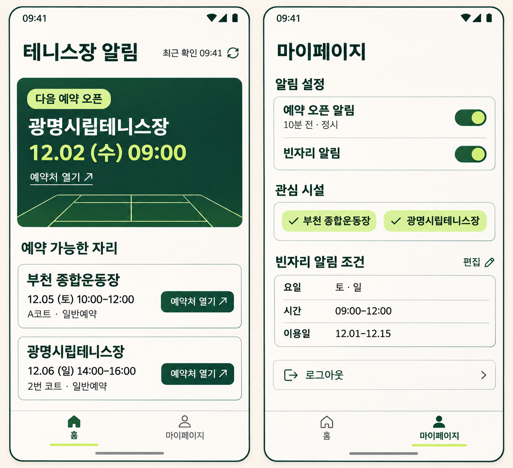

# 테니스장 예약 알림 앱 요구사항 및 인터뷰 결정

작성일 2026-11-17 (한국 시간). 이 문서는 첫 배포 범위, 인터뷰 결정, 화면 설계, 개발 설정, 배포 전 검증 항목을 담은 개발 기준 문서다. 예약처 원문과 개발에 필요한 링크를 본문에 기록한다.

## 1. 인터뷰에서 확정한 내용

| 항목 | 결정 |
| --- | --- |
| 서비스 목표 | 관심 시설의 예약 오픈 시점을 놓치지 않고, 원하는 시간에 예약 가능한 자리가 새로 생기면 원래 사이트에서 신속히 신청할 수 있다. |
| 초기 규모 | 10명 미만. AWS 인스턴스 한 대에 서버와 DB를 함께 두는 규모로 설계한다. |
| 배포 구성 | Docker Compose로 앱 서버를 실행한다. SQLite는 서버 컨테이너 안에서 실행하며 DB 파일은 영속 저장소에 둔다. 로그인과 푸시에는 Google이 운영하는 Firebase 서비스를 사용한다. |
| 우선 지원 | 부천시 공공서비스예약의 공공테니스장과 광명도시공사의 광명시립테니스장. |
| 배포 플랫폼 | Android만 지원한다. |
| 조회가 어려운 시설 | 코트·시간대 조회가 불가능하거나 허용되지 않으면 오픈 일정 알림과 공식 예약 링크만 제공한다. |
| 빈자리 알림 조건 | 시설, 요일, 시간대, 특정 이용일 또는 이용일 범위를 설정할 수 있다. |
| 예약 오픈 알림 | 오픈 10분 전과 오픈 시각에 각각 한 번 보낸다. |
| 파일럿 목표 | 조회 간격과 지연의 수치 기준은 시설별 실측 후 결정한다. 첫 배포에서 발송 지연, 알림 클릭, 클릭 시 앱이 아는 자리 상태를 기록하고 예약 성공·실패는 사용자가 선택적으로 응답한다. |
| 계정 | 서비스를 계정으로 로그인해 사용한다. 같은 계정으로 새 기기에 로그인하면 관심 시설과 알림 설정이 복구된다. |
| 기술 선호 | Node.js 서버와 Flutter 앱을 우선 검토한다. 최종 선택은 연동과 배포를 확인한 뒤 정한다. |
| 수집 경로 | 예약처별 공식 API를 우선한다. 해당 예약처에서 사용할 수 있는 API 또는 API 필수 설정이 없으면 지원되는 공개 예약 화면 수집으로 전환한다. 두 경로 모두 이용할 수 없는 시설은 오픈 일정과 링크를 제공한다. |
| 예약 실행 | 공식 브라우저 페이지에서 사용자가 직접 신청·인증·결제한다. 자동 예약은 별도 확장 후보로 둔다. |

## 2. 화면과 사용자 흐름

앱의 기본 화면은 하단 탭 `홈`과 `마이페이지` 두 개다. 마이페이지가 설정 화면 역할을 한다. 최초 로그인은 진입 과정에서 처리하고 알림 상세, 조건 편집과 예약 결과 입력에는 해당 탭의 카드나 바텀시트를 사용한다.

| 화면 | 요구사항 |
| --- | --- |
| 홈 | 선택한 시설에서 현재 예약 가능한 자리와 다음 오픈 일정을 구분해 보여준다. 빈자리 목록은 이용 시작 시각순으로 정렬하고 한 번에 10개씩 더 불러온다. 카드에는 시설, 코트, 이용 날짜·요일·시간, 마지막 확인 시각, 공식 예약 링크를 표시한다. 확인 가능한 요금과 관내우선 등 이용 조건을 함께 표기하고 확인되지 않은 값은 `예약처에서 확인`으로 표시한다. |
| 홈의 예외 상태 | `예약 가능한 자리 없음`, `현재 조회가 지연됨`, `오픈 알림만 지원`, `오픈 일정 미확인`을 구분한다. 관심 시설이 없으면 설정으로 연결한다. 오래된 조회 결과는 마지막 확인 시각과 함께 표시하며 현재 예약 가능 목록에서 제외한다. |
| 마이페이지 | 계정과 로그아웃, 관심 시설 복수 선택, 오픈·빈자리 알림 각각의 스위치, 빈자리 조건을 제공한다. Android 알림 권한이 꺼져 있으면 시스템 설정으로 이동할 수 있다. 조건 변경은 저장 이후 발생하는 알림부터 적용한다. |
| 알림을 열 때 | 해당 자리나 묶음, 또는 해당 오픈 일정으로 이동한다. 최신 서버 상태가 마감 또는 확인 불가를 나타내면 그 상태를 표시한다. 사용자는 공식 예약처를 열 수 있으며, 정확한 날짜·코트 링크를 제공할 수 없으면 시설 상세 링크와 선택할 날짜·코트 정보를 보여준다. |
| 예약처에서 돌아올 때 | 실제 예약 결과를 `성공`, `실패` 중 하나로 남기거나 건너뛸 수 있다. 응답은 선택 사항이며 예약 후 앱에 돌아오지 않은 경우 미응답으로 남긴다. |

홈의 상단에 마지막 확인 시각과 새로고침을 배치한다. 오픈 일정 카드는 오픈 시각을 먼저 보여주고, 빈자리 카드는 이용 날짜와 시간을 먼저 보여준다. 각각 `예약처 열기`를 제공한다. 홈 목록에는 관심 시설의 가용 자리를 표시하며 날짜·요일·시간 조건은 빈자리 푸시 발송에 적용한다. 마이페이지는 알림 스위치, 관심 시설, 저장된 요일·시간·이용일 조건을 한 화면에서 확인할 수 있게 구성한다. 디자인 시안의 일정과 자리 상태는 예시다.



### 관심 조건의 동작

- 시설 선택은 필수다. 요일, 이용 시간대, 이용일 단일 날짜 또는 기간은 각각 선택 사항이다. 비워 둔 항목은 제한 없이 적용한다. 시간대는 같은 날의 시작과 끝을 입력하며 슬롯 전체가 그 안에 들어올 때 매칭한다. 날짜와 요일은 한국 시간의 이용 시작일 기준이며 기간 양끝을 포함한다.
- 서로 다른 조건을 여러 개 저장할 수 있다. 한 조건 안에서는 입력한 항목을 모두 만족해야 하고, 여러 조건 중 하나라도 맞으면 알린다. 예를 들어 `부천 종합운동장 / 토·일 / 09:00~12:00 / 12월 1~15일`에 대해 12월 5일 10:00~12:00는 매칭하고 11:00~13:00는 매칭하지 않는다.
- 원본이 제공하는 코트별 예약 단위를 사용한다. 관내우선과 일반예약은 구분해 보여주며, 초기에는 사용자가 지원되는 접수 유형을 선택하고 실제 자격은 예약처에서 확인한다. 주소나 주민등록 정보를 앱에 입력할 필요는 없다.
- 오픈 알림은 선택한 시설 및 접수 유형의 일정에 적용한다. 빈자리의 이용 요일·시간 조건을 오픈 시각에 적용하지 않는다. 예를 들어 토요일 자리를 원하는 사람도 해당 기간의 수요일 오픈 알림을 받을 수 있다.

## 3. 오픈 일정과 빈자리 감지

**오픈 일정**은 운영자가 공식 공지를 확인해 시설, 접수 유형, 대상 이용 기간, 오픈 시각, 공식 출처, 확인 시각을 설정 파일이나 운영 명령으로 등록한다. 확정된 일정에 한해 알림을 예약한다. 수정·취소 시 아직 발송되지 않은 작업을 갱신하거나 무효화한다. 10분 전 단계와 정시 단계는 각각 한 번 발송 기록을 남긴다. 운영 중단으로 알림 시각을 놓치면 오래된 알림을 뒤늦게 보내기보다 홈에 최신 일정을 보여준다.

**빈자리**는 원본에서 관측한 날짜·자원·시간대·접수 유형 단위로 판단한다. `예약 불가 → 예약 가능` 전환이 확인되면 조건에 맞는 사용자에게 알린다. 원본에서 취소 사유가 확인되지 않는 경우 문구는 `예약 가능한 자리가 생겼어요`로 표시한다. 미결제 취소나 운영자의 추가 개방도 같은 전환으로 보일 수 있다.

빈자리 푸시는 시설명과 이용 날짜·요일·시간대를 담는다. 코트와 예상 금액은 출처에서 확인 가능할 때 추가한다. 오픈 푸시는 시설명, 접수 유형, 오픈 시각을 표시한다.

| 사례 | 처리 |
| --- | --- |
| 최초 수집 또는 감시 범위에 새 날짜가 들어옴 | 확인된 자리를 목록에 반영하고, 비교할 이전 상태를 저장한다. |
| 정기 오픈으로 예약 가능 자리가 한꺼번에 공개됨 | 빈자리 목록에 반영한다. 알려진 오픈과 일치하는 신규 공개분은 오픈 알림으로 처리한다. |
| 기존 슬롯이 예약 불가에서 가능으로 전환됨 | 빈자리 이벤트 한 건을 생성한다. 동일한 관측 결과나 겹치는 구독은 계정당 한 번 처리한다. 다시 마감된 뒤 재개되면 새 이벤트가 된다. |
| 한 번의 수집에서 여러 자리가 동시에 열림 | 같은 사용자에게 보낼 동일 시설의 자리를 한 건으로 묶을 수 있다. 고정된 시설별 1분 차단 대신 같은 이벤트의 중복을 막아 별도 날짜의 유효한 자리를 숨기지 않는다. |
| 오류, 빈 응답, 로그인 화면, 예상과 다른 응답 | 성공한 결과와 분리한다. 원본이 명시적으로 반환한 빈 목록만 정상으로 처리한다. 시간이 지난 마지막 정상 결과는 오래된 정보로 표시한다. 복구 시 마지막 정상 상태와 비교하며 간격이 커 비교가 불확실하면 기준 상태를 다시 만든다. |

예약처에서 조회한 상태와 사용자에게 보내려는 알림은 같은 DB 트랜잭션에서 기록하고, 같은 프로세스가 저장된 발송 대기를 처리한다. 발송 직전에 현재 조건, 이벤트 유효 시간, 원본의 마지막 확인 상태를 확인한다. 네트워크 오류는 유효 시간 안에서 제한적으로 재시도한다. 전송 결과가 불명확한 재시도에서는 중복 가능성이 있으므로 앱에서도 알림 ID를 이용해 중복 표시를 줄인다. 만료된 슬롯과 지난 오픈 안내는 발송 대기에서 제외하고 푸시 메시지에도 유효 시간을 둔다. [FCM 메시지 수명](https://firebase.google.com/docs/cloud-messaging/customize-messages/setting-message-lifespan)

## 4. 데이터 제공처 검증

| 대상 | 공개 자료에서 확인한 사실 | 파일럿에서 확인할 것 |
| --- | --- | --- |
| 부천시 공공서비스예약 | 종합운동장테니스장 등 여러 시설이 공개 목록에 있다. 목록의 `접수중`은 시설 단위 접수 상태다. [부천 테니스장 목록](https://reserv.bucheon.go.kr/site/main/lending/lendingList?inst_cate=01&lending_inst_nm=tennis), [종합운동장 상세](https://reserv.bucheon.go.kr/site/main/lending/lendingDetail?cp=1&inst_cate=01&lending_info_seq=115&listType=list&viewMode=list) | 종합운동장부터 확인한다. 다른 부천 시설은 운영자·규칙이 다를 수 있으므로 시설 단위로 자료와 응답을 확인해 추가한다. |
| 광명시립테니스장 | 일반예약 화면에 날짜별 가능·불가가 표시되고, 안내에서 일반과 관내예약을 구분한다. [예약 달력](https://reserve.gmuc.co.kr/user/tennis/tennisReservation.do?menu=d&menuFlag=T), [시설 및 공지](https://reserve.gmuc.co.kr/user/tennis/tennisMain.do?menuFlag=T) | 날짜별 표시를 넘어 코트·시간대까지 읽을 수 있는지, 일반과 관내우선의 공개 범위 및 접수 기간이 어떻게 다른지 확인한다. |
| 시설 목록용 공공데이터 | 서울 열린데이터광장과 공유누리에는 공공시설·예약 서비스 메타데이터가 있다. [서울시 체육시설 데이터](https://data.seoul.go.kr/dataList/OA-2266/A/1/datasetView.do), [공유누리 자원 상세](https://www.data.go.kr/data/15076179/openapi.do) | 초기 부천·광명 연동과는 별도로, 추후 시설 목록 확보에 활용할지 검토한다. 해당 데이터를 사용할 때 인증키 및 이용 조건을 확인한다. |

두 초기 예약처의 시간대별 공개 API, 인증키, 허용 조회 주기와 재표시 조건은 미확인이다. 다음을 예약처별로 기록한다.

1. 공식 API나 제휴 데이터 제공 여부, 신청 경로, 필요한 키와 호출량·갱신 주기를 확인한다. 인증키가 필요하면 발급 후 서버에 보관한다.
2. API 없이 공개 화면을 수집하려는 경우 공개 정책과 운영기관 안내로 자동 조회 및 앱 내 재표시 범위를 확인한다. 열람 범위, 가능한 호출 주기, 사이트가 요청 제한을 반환할 때의 처리 정책을 기록한다. 접근 승인이나 키가 필요한 경우 이를 확보한 상태에서만 연동 검증을 진행한다.
3. 정상 데이터에서 시설·코트 식별자, 이용일·시작/종료, 예약 상태, 예약 유형을 구분할 수 있는지 확인한다. 예약 가능, 마감, 공개 전, 운영 중단 사례를 공식 화면과 대조한다. 공개 응답에 예약자 정보가 섞이면 서비스에 필요한 상태와 시간 필드만 유지한다.
4. 통과한 시설에 빈자리 기능을 켠다. 오픈 일정만 지원하는 경우 시설별 배지를 표시한다. 공식 오픈 시각이 없으면 일정 미확인 상태와 예약 링크를 보여준다. 두 예약처 모두 시간대 연동을 통과하지 못하면 첫 배포는 오픈 알림 범위로 평가하고 취소 알림 검증은 보류 상태로 기록한다.

추후 후보인 광명시 체육시설 통합예약은 광명도시공사 시립테니스장과 별개 예약처로 취급한다. 인천 열우물, 강서구립·황금내와 구로 일대는 초기 배포 이후 검토한다. [광명시 체육시설 통합예약](https://gmsportscouncil.kr/reservation/reservation.php?facility=tennis-1), [인천 열우물 대관](https://icsports.or.kr/fmcs/6?action=list&facilities_type=C&center=ICYUM&part=01&place=5), [강서구 테니스장 예약 안내](https://sports.gangseo.seoul.kr/fmcs/64)

## 5. 파일럿 측정

| 지표 | 정의 및 한계 |
| --- | --- |
| 시설별 수집 상태 | 실행 횟수, 성공·실패 건수, 마지막 성공 시각, 연속 실패, 정상 조회 간격과 조회 응답 시간을 남긴다. 표본을 정해 공식 화면의 같은 코트·시간과 대조하고 일치율과 표본 수를 기록한다. |
| 감지 범위 | 직전 정상 확인 시각과 현재 감지 시각을 기록한다. 원본의 정확한 취소 시각을 모르면 이 사이에서 상태가 바뀐 것으로 관측한다. 원본 반영 지연과 조회 사이에 다시 마감된 건은 이 기록으로 측정할 수 없다. |
| 발송 지연과 오류 | 빈자리 감지 또는 예정된 오픈 알림 시각부터 FCM 요청 수락까지 걸린 시간과 실패 건수를 기록한다. FCM 수락 시각은 단말 표시 시각과 구분한다. 파일럿 실기기에서 푸시 수신 시각을 확인할 수 있는 표본은 따로 남긴다. |
| 클릭 이후 상태 | 계정별 이벤트의 첫 알림 열기와 공식 예약 링크 열기를 구분해 기록한다. 알림을 열 때 앱에 표시한 서버 최신 상태와 그 확인 시각을 함께 남긴다. `예약 가능`, `마감`, `확인 불가/정보 오래됨`으로 나누며, 이 값은 당시 서버가 아는 상태다. |
| 실제 예약 결과 | 슬롯별 자발적 성공·실패 응답과 응답 수를 집계한다. 성공 비율은 `성공 응답 / 전체 응답`으로 표시하고, 미응답은 실패에 넣지 않는다. |

일단 허용된 호출량과 원본 응답 구조에 맞춰 시설별 조회 간격과 범위를 설정한다. 시설에서 공개한 예약 기간 내에서 활성 구독의 날짜 범위를 합쳐 조회하며, 한 요청으로 여러 날짜를 확인할 수 있으면 요청을 공유한다. 같은 원본의 동시 호출을 억제하고 오류나 요청 제한 시 간격을 늘린다. 파일럿 보고에는 시설별 표본 수와 함께 조회 간격, 지연 분포, 클릭 당시 상태와 예약 응답을 포함한다. 이 결과로 수집 주기, 지원 범위, 알림 속도의 목표치를 결정한다.

## 6. 초기 구현과 운영 제안

아래는 인터뷰에서 정하지 않은 구현 기본값이다. 첫 연동과 테스트 기기에서 검증한 후 확정한다.

- **서버와 DB**는 Node.js + TypeScript와 SQLite를 우선 사용한다. AWS 인스턴스 한 대에서 API, 원본 조회 스케줄러, 발송 작업을 같은 애플리케이션으로 운영한다. Node.js 프레임워크로 NestJS를, 대안 스택으로 Spring과 FastAPI를 열어 둔다. 응답 속도는 원본 조회와 푸시를 포함한 흐름에서 실측한다. AWS 계정의 무료 플랜 또는 크레딧 자격, EC2·디스크·공인 IP·백업 비용을 배포 전에 확인한다. [AWS Free Tier](https://aws.amazon.com/free/)
- **앱과 로그인**은 Flutter Android, Firebase Authentication의 Google 로그인, FCM을 우선 검토한다. Android 네이티브가 필요하면 Kotlin·Java를, iOS 확장 시에는 Swift를 대안으로 검토할 수 있다. 서버에서 로그인 토큰을 검증하고 구독과 기기 토큰을 인증된 계정에 연결한다. 초기에는 승인된 계정에만 접근을 허용하고, 서명된 앱을 Firebase App Distribution으로 비공개 배포하는 방식을 제안한다. [Flutter 로그인](https://firebase.google.com/docs/auth/flutter/federated-auth), [서버 토큰 검증](https://firebase.google.com/docs/auth/admin/verify-id-tokens), [Android 테스트 배포](https://firebase.google.com/docs/app-distribution/android/distribute-console)
- **기기 교체** 시 로그인하면 서버의 관심 조건과 알림 설정을 다시 내려준다. 운영을 단순하게 하기 위해 계정당 사용자가 가장 최근에 알림을 활성화한 기기 한 대를 발송 대상으로 삼는다. 로그아웃한 기기는 발송 대상에서 해제한다. 토큰 갱신과 무효 토큰 삭제를 처리하고, 새 기기에서도 Android 권한 허용 상태를 확인한다. [Flutter FCM](https://firebase.google.com/docs/cloud-messaging/flutter/get-started), [Android 알림 권한](https://developer.android.com/develop/ui/compose/notifications/notification-permission)
- **화면 갱신**은 앱 시작·복귀·수동 새로고침과 포그라운드 주기 조회로 시작한다. 10초 간격은 앱이 서버의 저장된 결과를 읽는 시험값으로 사용한다. 수동 새로고침도 같은 결과를 읽으며 중복 진행 중인 요청은 하나로 합친다. 외부 예약처의 수집 간격은 별도로 설정한다. SSE는 실제로 화면 갱신 지연이 병목일 때 검토한다.
- **데이터**는 예약처, 시설·예약 자원, 시간대 관측값, 오픈 일정, 계정·기기, 관심 조건, 알림 이벤트·발송·클릭·응답을 저장한다. 동일한 슬롯은 예약처·시설·자원·시간대·접수 유형으로 구분하고, 외부 ID가 있으면 함께 저장한다. 시각은 UTC로 저장하고 한국 시간으로 표시·매칭한다. HTTPS를 적용하고 비밀 값과 푸시 토큰은 로그에서 제외한다. 파일럿 원시 이용 기록은 30일 후 삭제하는 초안으로 두고 계정별 설정과 기기 정보의 삭제 방법을 안내한다.
- **확장**은 원본 조회와 상태 변환을 예약처별 모듈에 두고, 앱과 알림은 공통 모델을 사용한다. 다음 종목에서는 코트를 구장 또는 대관 자원으로 바꿔 같은 모델을 사용하고, 추첨·현장 접수 등은 예약 유형으로 구분한다. 인천·구로·강서·전국 연동, GPS, iOS, 자동 예약은 별도 요구사항으로 다룬다. 자동 예약은 공식 지원 범위와 시설 운영 규칙을 기준으로 다시 판단한다.

## 7. Docker Compose와 Firebase

Compose의 기본 서비스는 `app` 한 개다. `app` 이미지에 Node.js 서버와 SQLite 라이브러리를 포함하고, 서버가 DB 파일을 직접 읽고 쓴다. SQLite에는 독립 서버 프로세스나 DB 포트가 없으므로 Compose에 SQLite 서비스와 포트를 추가할 필요가 없다. Android 앱은 기기에 설치하고, EC2의 앱 API에 HTTPS로 접속한다. 직접 HTTPS를 받아야 하는 배포에서는 리버스 프록시를 같은 Compose 파일에 추가할 수 있다. [SQLite 구조](https://www.sqlite.org/serverless.html)

- 개발에서는 Docker 관리 볼륨을 `app` 컨테이너의 `/app/data`에 연결한다. EC2에서는 EBS에 있는 호스트 디렉터리 `/var/lib/tennis-reservation`을 컨테이너의 `/app/data`에 연결한다. DB 파일과 SQLite가 사용하는 보조 파일을 같은 디렉터리에 보관한다. 서버가 첫 실행에 DB를 생성하고 마이그레이션하며 컨테이너를 교체해도 데이터는 유지된다. 운영 DB는 SQLite 백업 기능으로 복사해 인스턴스 밖에 보관한다. [Docker 볼륨](https://docs.docker.com/engine/storage/volumes/), [SQLite 백업](https://www.sqlite.org/backup.html)
- Firebase Authentication과 FCM은 Google 클라우드 서비스다. Flutter 앱은 SDK로 Google 로그인 후 발급받은 Firebase ID 토큰을 앱 API에 보내고, 서버는 Admin SDK로 토큰을 검증한다. 서버는 푸시를 보낼 때 Admin SDK를 통해 FCM에 HTTPS로 요청하고 FCM이 Android 기기로 알림을 전달한다. 서버 컨테이너에는 Admin SDK와 외부 HTTPS 연결, Firebase 프로젝트 설정 및 인증 정보가 필요하다. Firebase 서비스를 자체 운영하거나 Compose에 올릴 필요는 없다. [Firebase Admin SDK](https://firebase.google.com/docs/admin/setup), [FCM HTTP v1](https://firebase.google.com/docs/cloud-messaging/send/v1-api)
- 로컬에서는 샘플 데이터와 개발용 로그인·푸시 대체 구현으로 Compose를 실행할 수 있게 한다. 개발용 로그인은 운영에서 비활성화한다. 필요하면 Firebase Authentication 에뮬레이터를 로컬 전용 Compose 프로필에 추가할 수 있다. 실제 푸시는 Firebase 프로젝트와 Android 테스트 기기로 검증한다. [Firebase Local Emulator Suite](https://firebase.google.com/docs/emulator-suite)

## 8. 설정 파일과 수집 경로

다음 경로는 구현 시의 기본값이다. Compose 실행 시 `--env-file`에 호스트의 환경 파일 경로를 넘기고, Compose는 서버에 필요한 변수만 `app` 컨테이너에 주입한다. 배포 설정과 예시 파일은 구현 작업에서 추가한다.

| 설정 | 로컬 개발 | EC2 배포 |
| --- | --- | --- |
| 서버 환경 파일 | `%LOCALAPPDATA%\TennisReservation\server.env` | `/etc/tennis-reservation/server.env` |
| 공공 API | 설정 파일의 `BUCHEON_API_KEY`, `GMUC_API_KEY`. 실제 명세가 요구할 때 `BUCHEON_API_BASE_URL`, `GMUC_API_BASE_URL` 및 예약처별 추가 값을 설정한다. | 같은 이름으로 EC2 환경 파일에 설정한다. |
| Firebase 서버 설정 | `FIREBASE_PROJECT_ID`를 설정한다. JSON 키를 사용할 때 `FIREBASE_CREDENTIALS_FILE`에 `%LOCALAPPDATA%\TennisReservation\firebase-service-account.json` 등 호스트의 실제 절대 경로를 지정한다. | 같은 프로젝트와 권한을 쓸 경우 동일한 설정을 사용한다. 호스트 파일의 기본 경로는 `/etc/tennis-reservation/firebase-service-account.json`이다. |
| Firebase 앱 설정 | Flutter 프로젝트의 `app/lib/firebase_options.dart`와 Gradle 구성이 사용하는 `app/android/app/google-services.json`. `app/`은 예정된 Flutter 프로젝트 경로다. | Android 빌드에 같은 앱 설정을 적용한다. 서버 주소는 Android 빌드의 `API_BASE_URL`에 공개 HTTPS URL을 지정한다. |
| SQLite | 컨테이너 내부의 `SQLITE_DB_PATH=/app/data/tennis-reservation.sqlite`. `/app/data`는 Docker 볼륨이다. | 컨테이너 내부 경로는 동일하다. `/app/data`를 EBS의 호스트 디렉터리에 연결하고 컨테이너 실행 사용자에게 디렉터리 쓰기 권한을 준다. |

공공 API 발급 시 전달할 것은 제공처·API 명세 링크·신청 상태와 설정이 필요한 항목의 이름이다. 실제 키와 Firebase 서비스 계정 JSON은 본인이 환경 파일과 지정 경로에 넣고 읽기 권한을 제한한다. 실서비스 설정에서만 Compose가 JSON 파일을 `/run/secrets/firebase-service-account.json`에 읽기 전용으로 연결하고, 컨테이너의 `GOOGLE_APPLICATION_CREDENTIALS`는 그 경로를 가리킨다. 저장소와 Docker 이미지에는 비밀 값이 없는 설정 예시를 둔다. Flutter 설정 파일은 앱 식별용 구성이다. [Flutter Firebase 구성](https://firebase.google.com/docs/flutter/setup), [Firebase 서버 인증](https://firebase.google.com/docs/admin/setup)

1. 예약처별 어댑터는 검증된 공식 API가 있고 필수 설정값이 모두 있을 때 API를 선택한다. 키·승인·필수 식별값이 비어 있거나 시간대 API를 제공하지 않으면 그 예약처에 대해 검증된 공개 화면 수집기를 선택한다. 한 예약처의 설정 누락은 다른 예약처에 영향을 주지 않는다.
2. API가 정상적으로 빈 목록을 반환하면 그대로 처리한다. 설정이 있는 API에서 인증 오류, 일시 장애, 호출 제한이 발생하면 원인을 기록하고 원본별 호출 제한에 따라 대기한다. 누락된 설정으로 인한 시작 시 선택과 운영 중 오류는 별도로 처리한다.
3. 공개 화면 수집 경로는 4절 검증을 거쳐 활성화한다. 시간대 조회 경로를 둘 다 쓸 수 없으면 오픈 일정과 링크를 제공한다. 앱에서 보이는 `조회 지연`과 `오픈 알림만 지원`은 각각 일시 장애와 시설 지원 범위를 뜻한다.

## 9. 사용자와 개발 작업의 분담

| 시점 | 사용자가 준비할 것 | 개발 작업 |
| --- | --- | --- |
| 로컬 개발 시작 | 공공 API를 발급받았다면 명세와 필수값을 준비한다. Firebase 프로젝트는 본인 계정에 만들어 프로젝트 ID를 확인해 둔다. | 예제 응답과 가짜 로그인·푸시를 사용하는 로컬 개발 모드를 제공한다. 앱 두 화면, 계정별 설정, 예약처 어댑터, SQLite 생성과 스키마 마이그레이션을 구현한다. |
| Google 로그인·푸시 실기기 테스트 | 개발 시 전달하는 Android `applicationId`로 Firebase에 앱을 등록하고 Google 로그인 제공업체를 켠다. 개발 시 제공하는 실제 테스트 APK 서명 인증서의 SHA-1 지문을 등록한다. 필요에 따라 Cloud Messaging API(HTTP v1)를 활성화하고, 서버 서비스 계정 인증을 준비한다. JSON 키 방식이면 지정 경로에 보관한다. | 패키지 ID와 서명 지문을 전달하고, 해당 프로젝트의 FlutterFire 구성과 토큰 검증, FCM 발송·수신을 연결한다. 필요한 경우 갱신된 `google-services.json`을 적용한다. Android 실기기에서 로그인과 푸시를 확인한다. [Android Google 로그인](https://firebase.google.com/docs/auth/android/google-signin), [FCM 서버 인증](https://firebase.google.com/docs/cloud-messaging/auth-server) |
| 비공개 배포 | 초기 테스트에 쓸 Google 계정과 Android 기기를 준비한다. Firebase App Distribution을 쓰면 초대할 테스터 계정을 준비한다. 실제 배포 APK를 서명하는 인증서의 지문도 개발용과 다르면 Firebase에 추가한다. | 서명된 APK 빌드와 비공개 설치 절차를 제공하고, 기기 변경 후 설정이 복구되는지 검증한다. [Android 테스트 배포](https://firebase.google.com/docs/app-distribution/android/distribute-console) |
| AWS 실배포 | AWS 계정과 비용 알림, Linux EC2 한 대, 영속 EBS 저장 위치, 공개 HTTPS 주소를 마련한다. DNS 이름으로 구성한다면 도메인·DNS 권한과 유지할 접속 주소를 준비한다. 배포에 필요한 인스턴스 접속 권한을 마련하고 운영 서버의 환경 파일에 직접 비밀 값을 넣는다. | `Dockerfile`과 `compose.yaml`, EC2에 Docker Engine과 Compose를 설치하는 절차, 앱 실행·자동 재시작 설정, HTTPS 연결 방법, 상태 확인, DB 백업·복구 절차를 제공한다. [AWS Free Tier 사용량 확인](https://docs.aws.amazon.com/awsaccountbilling/latest/aboutv2/tracking-free-tier-usage.html) |

## 10. 개발 순서와 완료 기준

1. **데이터 검증.** 부천 종합운동장과 광명시립을 먼저 조사한다. 실제 시간대 응답과 공식 화면의 일치, 조회 허용 범위, 사용 가능한 예약 링크, 최신 공지의 오픈 시각을 기록한다. 확인 결과를 기준으로 시설마다 제공할 기능을 결정한다.
2. **단일 서버.** Compose로 서버가 시작되고 DB가 자동으로 생성되는지 확인한다. 시설과 일정을 등록하고 계정별 조건을 저장한다. 샘플 상태를 통해 최초 수집, 상태 전환, 정기 오픈, 동일 상태 반복, 조회 실패와 복구, 오픈 일정 수정으로 이전 발송 작업이 취소되는지 확인한다. 컨테이너 재생성 후 SQLite 설정과 대기 알림이 유지되는지, 백업으로 복원할 수 있는지 확인한다.
3. **Android 배포.** 로그인과 설정 저장, 같은 계정으로 두 번째 기기에서의 설정 복구, 서로 다른 계정의 데이터 분리, 권한 허용·거부, 앱이 닫힌 상태의 알림 수신을 시험한다. 알림을 누르면 해당 카드와 공식 예약처로 이동하며 선택 응답을 남길 수 있어야 한다.
4. **파일럿 종료 판단.** 확정 일정이 있는 시설의 10분 전·정시 알림과, 연동이 확인된 시설의 빈자리 알림을 검증한다. 실제 전환 사례가 희소하면 샘플로 흐름을 검증하고 실제 시설 측정 건수는 따로 기록한다. 수집 상태와 알림 지표를 시설별로 확인한 뒤 운영 주기와 다음 지원 시설을 결정한다.

<details>
<summary>홈·마이페이지 목업 생성 프롬프트 (내장 ImageGen)</summary>

```text
Use case: ui-mockup. Create one refined high-fidelity UI concept board with exactly two large flat upright Android app screen mockups side by side on a warm off-white background, left Home and right My page, same app for tracking tennis court availability in Korea. Square-ish landscape board, screens vertically complete, widest possible in canvas for legibility. No headings outside the phones and no slanted devices. Quiet sporty look, Korean typography, generous spacing, ivory backgrounds, forest green #183C30 primary text and actions, soft lime #DDF293 accent, fine lines evoking a tennis court only inside the primary card. Large readable Hangul, impeccable spelling. On left use title "테니스장 알림", small "최근 확인 09:41" with refresh icon. Solid green calendar card with "다음 예약 오픈", "광명시립테니스장", "12.02 (수) 09:00", small link "예약처 열기 ↗". Then heading "예약 가능한 자리". White bordered cards, one with "부천 종합운동장", "12.05 (토) 10:00–12:00", "A코트 · 일반예약", button "예약처 열기 ↗"; another with "광명시립테니스장", "12.06 (일) 14:00–16:00", "2번 코트 · 일반예약". Right screen title "마이페이지". Section "알림 설정" with distinct Android toggles ON for "예약 오픈 알림" and "빈자리 알림"; under open reminder "10분 전 · 정시". Section "관심 시설" with two selected pills "부천 종합운동장" and "광명시립테니스장". Section "빈자리 알림 조건" with concise rows "요일  토 · 일", "시간  09:00–12:00", "이용일  12.01–12.15" and an edit affordance. Small account action "로그아웃". Both screens share exactly two labeled bottom destinations "홈" and "마이페이지", with appropriate selected state. No map, booking calendar, third tab, filler badges, price, logos, photos, device outside the two screens, extra decorative text or lorem ipsum. All entries are illustrative, not live data.
```

</details>
